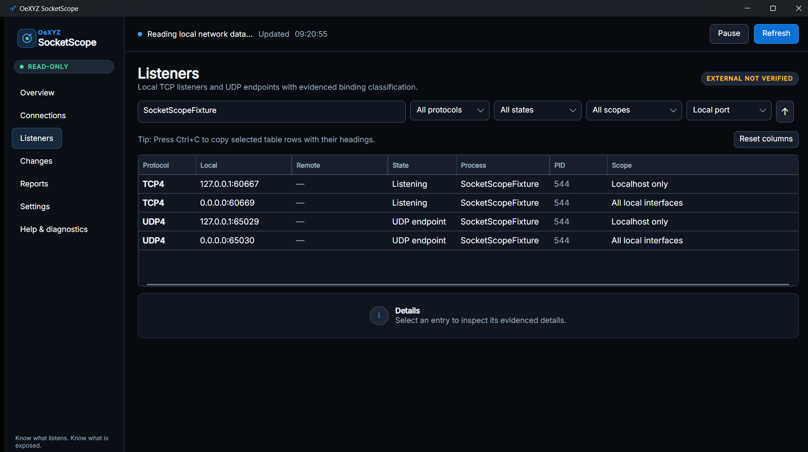
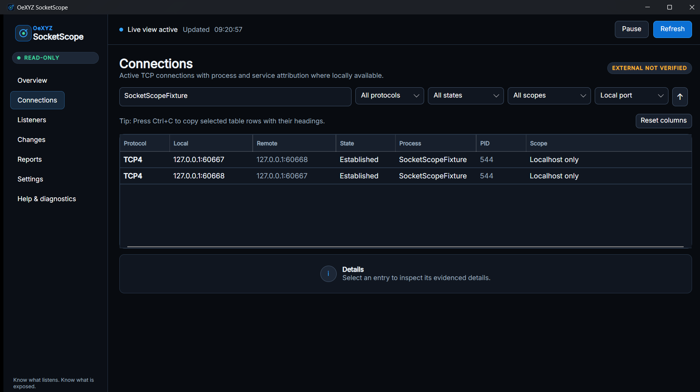
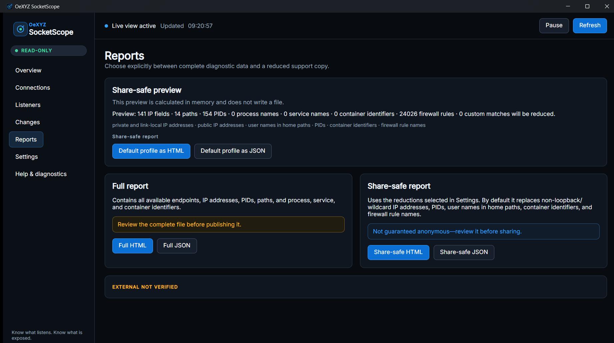
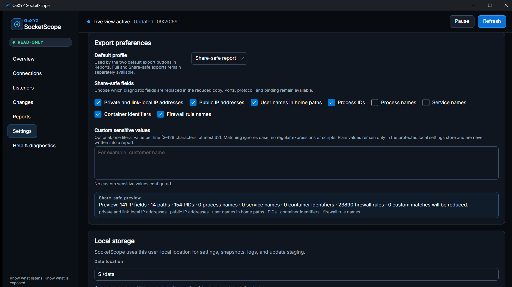
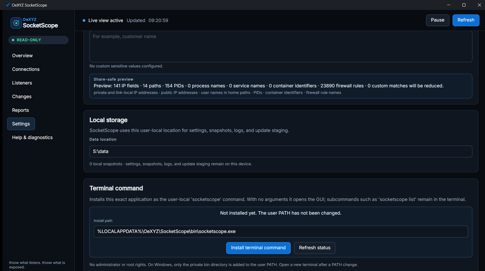
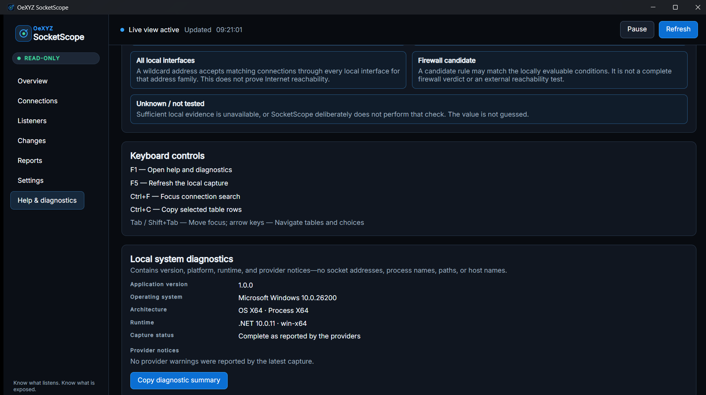
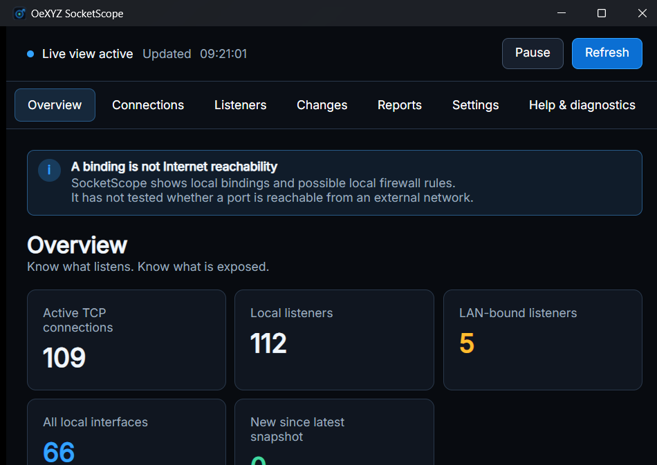
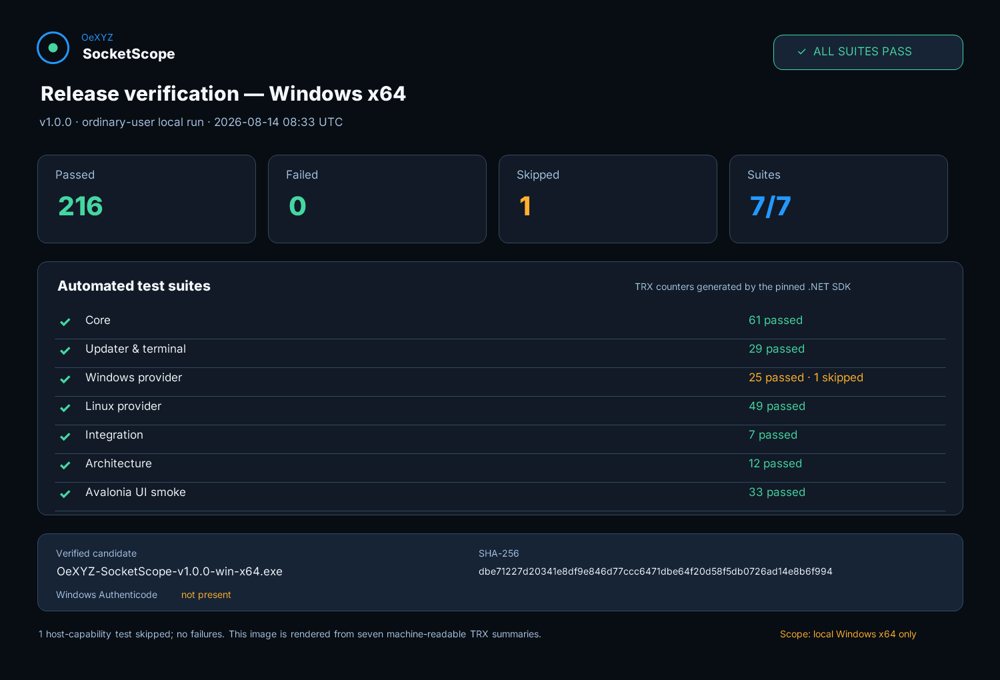

# OeXYZ SocketScope

> **Know what listens. Know what is exposed.**

<p align="center">
  <a href="https://github.com/Oexyz/SocketScope/actions/workflows/ci.yml"></a>
  <a href="https://github.com/Oexyz/SocketScope/releases/latest"></a>
  
  
  
  
  
  <a href="LICENSE"></a>
</p>

SocketScope is a local, read-only network endpoint inspector for Windows and Linux.
It connects socket data with processes, services, containers, interface bindings, and
candidate firewall rules without pretending that local evidence proves Internet
reachability.

> **Deutsch:** SocketScope zeigt verständlich, welche Programme lokale Ports und
> Verbindungen verwenden. Die Anwendung arbeitet standardmäßig rein lokal, ohne
> Telemetrie, Konto oder Cloud-Abhängigkeit.

Eine verständliche deutsche Einordnung mit Stärken, Grenzen und typischen
Einsatzfällen steht in [Was SocketScope leistet – und was nicht](docs/EINFUEHRUNG.de.md).



> The screenshot is captured from a real release-candidate run with controlled local
> sockets. No production host addresses or user data are included.

## Why SocketScope

Operating-system tools usually expose either raw tables or a platform-specific expert
view. SocketScope is intended for developers, administrators, support engineers, and
homelab operators who need one answerable trail:

- Which process owns this TCP connection, TCP listener, or UDP endpoint?
- Is it bound only to loopback, one local interface, or every local interface?
- Which service or container can be attributed with the current user rights?
- Which local firewall rules may be relevant, and which conditions were not evaluated?
- What changed between two observations or saved snapshots?
- Which evidence belongs in a complete local report, and which reduced copy is more
  suitable for a support request?

SocketScope is **not** a port scanner, packet sniffer, firewall, vulnerability scanner,
or proof of external reachability. A wildcard binding such as `0.0.0.0` or `::` means
that a program accepts traffic on all matching local interfaces. It does **not** prove
that a router, NAT, cloud policy, upstream firewall, VPN peer, or the Internet can
reach that port.

## Current feature set

- Live TCP connections, TCP listeners, and UDP endpoints for IPv4 and IPv6.
- Local/remote endpoint, connection state, process name, PID, and executable path when
  the operating system permits access.
- Best-effort Windows service, systemd/cgroup, and container attribution with explicit
  availability states.
- Binding classification for loopback, specific interfaces, LAN/private context, and
  wildcard bindings.
- Candidate local firewall evidence. It is never presented as an effective end-to-end
  verdict.
- Search, protocol/state/scope filters, deterministic sorting, pause/resume, stable
  selection, drag-to-reorder and resizable table columns, and new/removed/changed
  highlights.
- Keyboard table copying with localized headings, resettable column layouts, and
  explicit actions for local/remote endpoints, executable paths, complete details,
  and a Share-safe single-endpoint summary.
- An offline `F1` help and diagnostics view with binding/firewall terminology,
  keyboard shortcuts, and copyable runtime/provider status that excludes observed
  socket addresses, process names, paths, and host names.
- Secure local snapshots and deterministic snapshot comparison.
- Explicit **Full report** and **Share-safe report** exports as inert HTML or JSON.
  The reduced copy is a convenience, not a guarantee of anonymity.
- Up to 32 optional custom sensitive literals can be kept in the protected local
  settings store and replaced in Share-safe attribution/evidence text without writing
  their plaintext into the report.
- English and German UI/CLI. English is the first-run default; a language preference
  is stored only after the user changes it.
- Bounded metadata-only local event logs containing no socket values, paths, log
  parameters, exception text, or command lines.
- Optional GitHub update checks, disabled by default. The integrated updater accepts
  only stable immutable releases, verifies size and SHA-256, and after a visible
  preview plus explicit confirmation applies the update with health-check rollback and
  restart.

## Release-candidate screenshots

These images were captured from the self-contained Windows release candidate as an
ordinary user. The listener and connection views use a controlled local socket fixture;
the compact overview contains counts only, Settings uses a temporary sanitized
data-drive alias, and Help/Diagnostics contains metadata-only system status. Every
full-resolution image was reviewed for clipped controls, complete column headings,
desktop/taskbar content, user names, host names, home paths, and unrelated addresses
before inclusion.

### Active TCP connections



### Explicit report profiles



### Configurable Share-safe export



### Terminal command in Settings



### Offline help and local diagnostics



### Responsive compact layout



## Supported platforms

| Platform | Release target | Status | Primary data source |
|---|---:|---|---|
| Windows 10/11 x64 | `win-x64` | Supported | Documented IP Helper and Service Control Manager APIs |
| Windows 11 ARM64 | `win-arm64` | Build target; hardware validation required for each release | Same documented native APIs |
| Linux x64 | `linux-x64` | CLI/provider validated in WSL 2 and Debian Docker; native desktop validation still required per release | Kernel `NETLINK_SOCK_DIAG`, `/proc` ownership/process data, optional bounded `nft` evidence |
| Linux ARM64 | `linux-arm64` | Build target; hardware validation required for each release | Same Linux providers |

See [platform support](docs/PLATFORM-SUPPORT.md) for exact limitations. macOS and BSD
are not supported by 1.0. The GUI must run as an ordinary user; SocketScope neither
requests elevation nor installs a privileged service.

## Installation

Release assets are self-contained and do not require a separate .NET installation.
They still rely on operating-system libraries such as glibc, ICU, the desktop's
X11/XWayland client libraries, Fontconfig, and FreeType on Linux; a normal current
desktop installation usually provides them.
Official builds are published on the
[GitHub Releases page](https://github.com/Oexyz/SocketScope/releases). Treat artifacts
built locally from an untagged or modified source tree as development builds.

### Windows single executable

1. Download the `.exe` matching `win-x64` or `win-arm64`.
2. Verify its checksum and provenance as described below.
3. Place it in a user-controlled directory and run it as an ordinary user.

The Windows download is exactly one executable. It contains the desktop UI, CLI,
update verifier, .NET runtime, local Inter font, application icon, and legal notices.
Run it with `--notices` to read the embedded license and third-party notices.

To add the same application as the user-local `socketscope` command, run once from
PowerShell or Windows Terminal:

```powershell
.\OeXYZ-SocketScope-v1.0.0-win-x64.exe shell install
```

The same explicit action is available under **Settings → Terminal command**. That
section displays the fixed user-local target, checks whether the installed copy matches
the running application, and reports whether a new terminal is required. It never asks
for administrator rights.

No administrator rights are requested. SocketScope copies itself atomically to
`%LOCALAPPDATA%\OeXYZ\SocketScope\bin\socketscope.exe`, verifies the copy, protects the
directory with a current-user DACL, and appends that directory to the current user's
PATH. It refuses installation if a different filesystem command named `socketscope`
is already on the process, user, or machine PATH. Open a new terminal afterward:

```powershell
socketscope            # open the GUI
socketscope gui        # open the GUI explicitly
socketscope list       # remain in the terminal
socketscope shell status
```

The release remains a single downloadable EXE. Once the installed command works, the
original downloaded copy can be removed. Launching the installed `socketscope` command
also gives the confirmed updater a stable user-owned executable to replace safely.

### Linux tar.gz

1. Download the archive matching `linux-x64` or `linux-arm64`.
2. Verify its checksum and provenance.
3. Extract it into a user-controlled directory.
4. Run `./OeXYZ.SocketScope`.

Optional terminal integration copies that same binary to `~/.local/bin/socketscope`:

```bash
./OeXYZ.SocketScope shell install
```

SocketScope enforces mode `0700` on its private install directory and executable. It
does not edit `.profile`, `.bashrc`, `.zshrc`, or other shell startup files. If
`~/.local/bin` is not already in `PATH`, add it using the normal configuration for
your shell and open a new terminal.

The Linux desktop baseline is a current glibc distribution in an X11 or XWayland
session. Minimal containers and WSL installations may need their distribution's ICU
and desktop client-library packages. The CLI does not require a graphical session.

Desktop integration packages such as MSI, DEB, RPM, and AppImage are roadmap items,
not 1.0 deliverables.

### Portable data mode

Run the desktop application with `--portable` to place settings, snapshots, and logs in
`SocketScopeData` beside the executable:

```powershell
./OeXYZ.SocketScope.exe --portable
```

```bash
./OeXYZ.SocketScope --portable
```

Use portable mode only in a private, writable directory. A shared or removable drive
can provide weaker permission guarantees. SocketScope fails a protected write when the
platform cannot enforce its file-safety checks. On Linux, select a filesystem that
enforces Unix ownership and `0700`/`0600` modes; Windows-mounted WSL DrvFS locations
can fail this check by design.

## CLI examples

The examples below use the optional stable terminal command. Every command is also
available directly from the downloaded Windows EXE or extracted Linux binary.

```bash
# Human-readable listeners and UDP endpoints (Windows)
socketscope --language en list --role listener

# Machine-readable active TCP connections
socketscope list --protocol tcp --role connection --json

# Pauseable polling is available in the desktop; CLI watch is bounded on request
socketscope watch --interval 2000 --iterations 5

# Save and compare local snapshots
socketscope snapshot save snapshot-a.json
socketscope snapshot compare snapshot-a.json snapshot-b.json

# Complete diagnostic report (the default)
socketscope report full-report.json --format json
socketscope report full-report.html --format html

# Reduced copy intended for a support request
socketscope report support-report.json --format json --share-safe
socketscope report support-report.html --format html --share-safe
```

The desktop exposes the same two choices as separate buttons. Full reports can contain
all locally available IP addresses, PIDs, executable paths, and identifiers. A
Share-safe report reduces common personal identifiers while preserving useful binding
and process context; inspect it before publishing.

## Local behavior and report contents

SocketScope has no telemetry, analytics SDK, advertising, account, cloud sync, reverse
DNS lookup, or runtime-loaded web asset. Opening the application and inspecting local
sockets causes no application-originated network request. An update check contacts the
fixed public GitHub Releases API only after the user clicks the check button or has
explicitly saved the automatic-check opt-in.

Live views, snapshots, and Full reports can contain IP addresses,
process/service/container names, PIDs, timestamps, and user names in executable paths.
The optional Share-safe profile is configurable under **Settings → Export**. Its
defaults:

- tokenize non-loopback IP addresses, PIDs, observation IDs, container identifiers,
  and firewall-rule names;
- remove user-name segments from recognized home-directory paths;
- omit command-line arguments and environment data because the MVP does not collect
  them;
- retain process and service names because removing them can destroy the reason for a
  diagnostic report. These categories can also be tokenized explicitly.
- replace optional custom literals entered under **Settings → Export**. Matching is
  case-insensitive and literal only—never a regular expression or script. Their
  plaintext remains in the protected local settings file; reports contain only the
  configured count, replacement count, and per-report tokens.

The CLI intentionally has no option that places a sensitive literal in the process
command line. Custom literals currently apply to desktop-generated Share-safe reports;
CLI Share-safe reports use the reviewed category defaults.

Share-safe does not claim automatic anonymity. Review any file before sharing it.
Details are in [Security and privacy](docs/SECURITY-AND-PRIVACY.md) and the
[export format](docs/EXPORT-FORMAT.md).

## Security model

SocketScope is read-only by design. It does not terminate processes, restart services,
change firewall rules, block ports, control containers, or run a privileged helper.
Observed facts, derived binding classifications, firewall candidates, unavailable
fields, and untested external reachability remain separate in the data model and UI.

The updater uses a fixed repository and API host, rejects drafts, prereleases, and
mutable releases, requires an exact platform asset name and GitHub-provided SHA-256
digest, bounds metadata and package sizes, and restricts redirects to GitHub
release-asset hosts. Checks are off by default. When an update exists, the desktop
shows its version, origin, size, and digest; installation starts only after an explicit
click. An unprivileged helper rechecks the staged asset and current executable, waits
for SocketScope to close, replaces it with a rollback copy, runs the new executable's
health check, rolls back on failure, and otherwise restarts it. It never requests
elevation.

The local updater does not yet verify a GitHub artifact attestation or Windows
Authenticode status. Release consumers should additionally verify GitHub provenance;
a matching checksum alone is not a claim that the source or build is safe.

Read the full [threat model](docs/THREAT-MODEL.md). To report a vulnerability, follow
[SECURITY.md](SECURITY.md) and do not open a public issue with exploit details.

## Known limitations

- External reachability is always **not tested** in 1.0.
- Firewall matching is intentionally partial and cannot reproduce every Windows
  Filtering Platform, Group Policy, nftables, firewalld, IPsec, or third-party rule.
- Process, service, and container attribution can be unknown because a process exited,
  a PID was reused, permissions are missing, or the current namespace lacks evidence.
- Linux enumeration uses bounded kernel `NETLINK_SOCK_DIAG` dumps for IPv4/IPv6 TCP
  and UDP, then correlates inodes through accessible `/proc/<pid>/fd`. Strictly parsed
  `/proc/net` tables are the fallback when sock_diag is unavailable or invalid. `ss`
  and `lsof` are never required.
- Linux self-contained archives include .NET and managed dependencies, but not glibc,
  ICU, X11/XWayland, Fontconfig, or FreeType supplied by the distribution.
- WSL is useful for CLI/provider testing but is not the Linux desktop support baseline;
  its mounted Windows filesystems may be rejected for protected application storage.
- Container port-forward attribution is best effort and does not open Docker or Podman
  control sockets.
- Windows ARM64 and Linux ARM64 artifacts require per-release hardware smoke-test
  evidence before they can be called validated.
- Windows Authenticode status for 1.0 is **not present**. SHA-256 and GitHub artifact
  attestations remain available as separate verification layers; they do not provide
  Windows SmartScreen reputation.

## Build from source

Prerequisites: the .NET SDK pinned in [`global.json`](global.json), Git, and the native
desktop libraries normally present on the target OS.

```bash
dotnet restore OeXYZ.SocketScope.slnx --locked-mode
dotnet build OeXYZ.SocketScope.slnx --configuration Release --no-restore
```

Run the applications:

```bash
dotnet run --project src/OeXYZ.SocketScope.Desktop --no-build
dotnet run --project src/OeXYZ.SocketScope.Desktop --no-build -- list
dotnet run --project src/OeXYZ.SocketScope.Desktop --no-build -- update --current 1.0.0
```

The release workflow builds single-file applications for all four runtime IDs. Windows
uses a direct `.exe`; Linux wraps its single binary and documentation in `tar.gz` to
preserve Unix permissions. The workflow creates a draft release and does not publish
it; publication requires owner approval after the documented evidence review. Build
instructions and package layout are detailed in [Testing](docs/TESTING.md) and
[Architecture](docs/ARCHITECTURE.md).

## Tests

```bash
dotnet test OeXYZ.SocketScope.slnx --configuration Release --no-restore
```

The suite contains core classification/diff/export tests, native parser fixtures,
secure-storage race/permission cases, live platform probes, CLI integration tests,
updater tamper/redirect tests, architecture rules, and Avalonia headless smoke tests.
Platform tests report explicit skips when the host cannot safely create a required
symlink or lacks the corresponding OS facility. See [docs/TESTING.md](docs/TESTING.md)
for the release evidence and manual accessibility matrix, and the
[release-candidate audit](docs/RELEASE-CANDIDATE-AUDIT.md) for a requirement-by-requirement
status and its explicit validation boundaries.



The checked-in image is rendered from seven machine-readable TRX summaries rather than
typed-in totals. Its matching sanitized evidence record is
[docs/release-evidence/windows-x64-local.json](docs/release-evidence/windows-x64-local.json).
It covers the local Windows x64 candidate only; native Linux and ARM64 release checks
remain separate release gates.

## Architecture

```text
Desktop ─┬─> Core <─┬─ Windows provider
         │          └─ Linux provider
CLI ─────┘

Desktop ──> narrowly scoped update client <── fixed GitHub Releases API (opt-in)
```

Core owns immutable models, capture orchestration, classification, diffing, snapshots,
the Full/Share-safe report profiles, and exports. Platform projects implement typed
operating-system evidence.
Desktop and CLI are unprivileged composition roots. See
[docs/ARCHITECTURE.md](docs/ARCHITECTURE.md).

## Release verification

Each official release is expected to contain application assets, `SHA256SUMS`, an SPDX JSON SBOM,
and GitHub artifact attestations. On Windows:

```powershell
Get-FileHash .\OeXYZ-SocketScope-v1.0.0-win-x64.exe -Algorithm SHA256
```

On Linux:

```bash
sha256sum --check SHA256SUMS
```

Verify provenance against the exact repository and release workflow:

```bash
gh attestation verify OeXYZ-SocketScope-v1.0.0-linux-x64.tar.gz \
  --repo Oexyz/SocketScope \
  --signer-workflow Oexyz/SocketScope/.github/workflows/release.yml
```

For immutable GitHub releases, `gh release verify v1.0.0 -R
Oexyz/SocketScope` additionally verifies GitHub's release attestation.
Do not bypass a failed checksum, provenance, expected-name, or origin check.

## Contributing

Read [CONTRIBUTING.md](CONTRIBUTING.md) and the
[Code of Conduct](CODE_OF_CONDUCT.md). Small, test-backed changes with explicit
platform behavior are preferred. Do not attach raw endpoint tables, reports, logs,
credentials, or customer data to public issues.

## Roadmap

After a reliable 1.0 baseline, possible work includes stronger container/NAT evidence,
opt-in external checks, remote hosts, notifications, package
formats, and carefully isolated privileged actions. Process termination, service
restart, firewall changes, and container control require a new threat-model review,
preview, explanation, and explicit confirmation. They are not silently enabled here.

See [CHANGELOG.md](CHANGELOG.md) for implemented changes and
[docs/IMPLEMENTATION-PLAN.md](docs/IMPLEMENTATION-PLAN.md) for milestone gates.

## Support my work

If SocketScope is useful to you, you can voluntarily support continued development,
documentation, testing, and the infrastructure required for this open-source work.
Support does not create an entitlement to a service, feature, release date, or other
consideration. It is not a tax-deductible donation, and no donation receipt is issued.

### Bitcoin · BTC Mainnet

```text
bc1qxdnzh04j2mk4wqp86ptmpa7dup4275cl7laqcg
```

### Monero · XMR Mainnet

```text
46MYiEMqAe3gnd7tveoqzC42yp83UXBM93B7UJnfV9SS5sXjiKgRiChZRgThrKtwmjUkT9kUCAexJUM7toTvaCdtVaPhDGe
```

Before sending, verify the asset, network, and complete receiving address against the
[OeXYZ GitHub profile](https://github.com/Oexyz#support-development). Cryptocurrency
transactions are generally irreversible; use a small test amount if you are unsure.

## License and notices

SocketScope is licensed under the [MIT License](LICENSE). Runtime dependencies, the
locally embedded Inter font, licenses, and provenance are listed in
[THIRD_PARTY_NOTICES.md](THIRD_PARTY_NOTICES.md).
